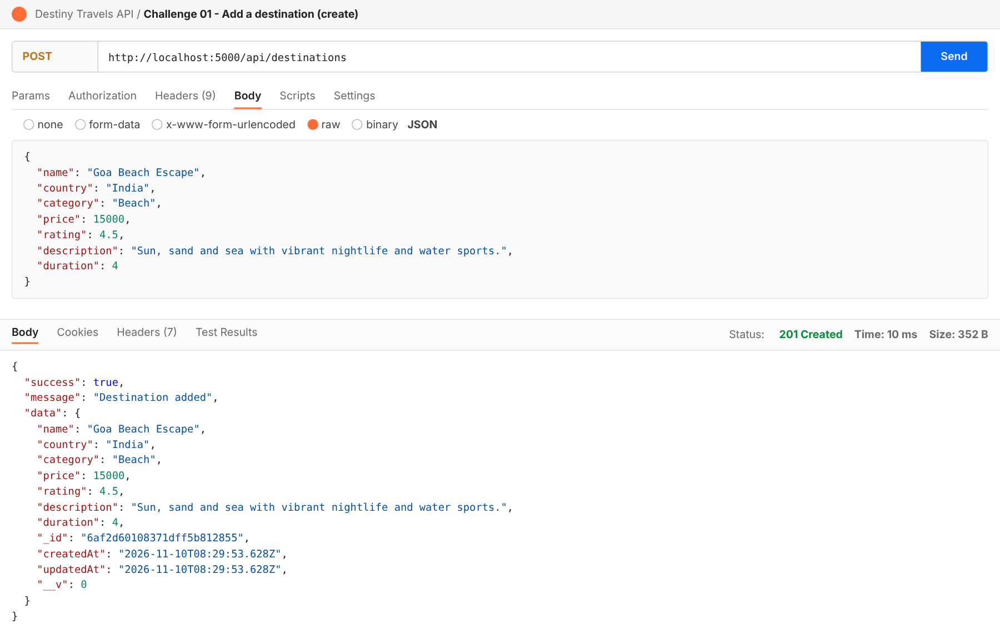
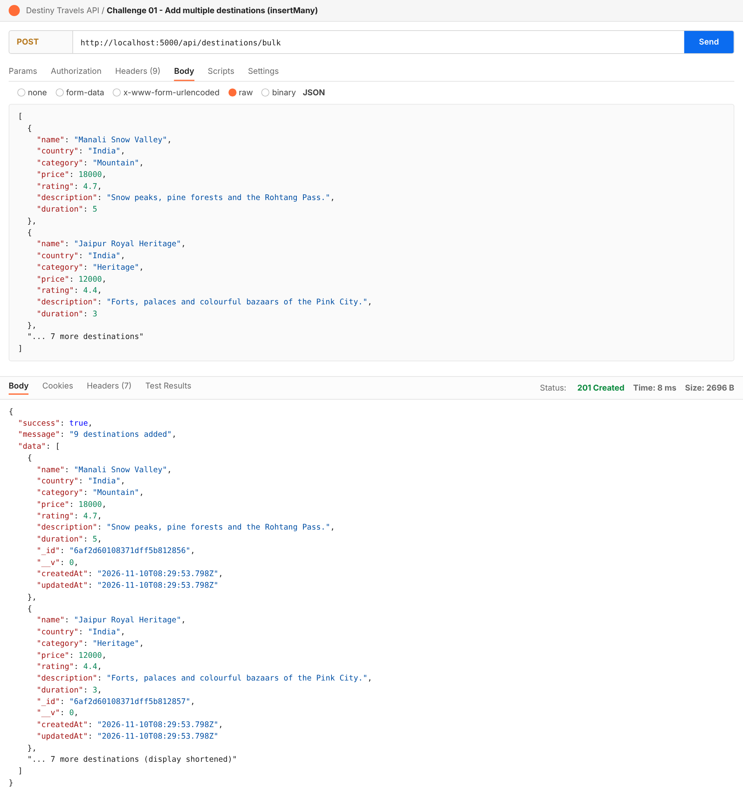
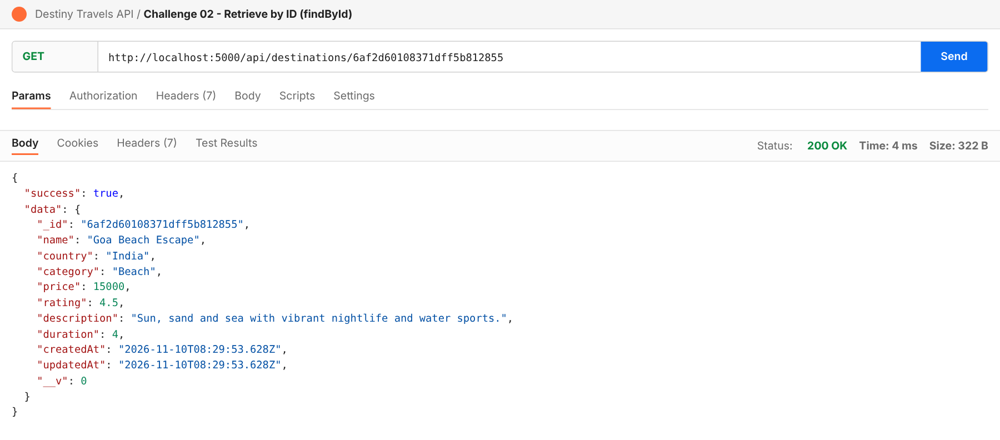
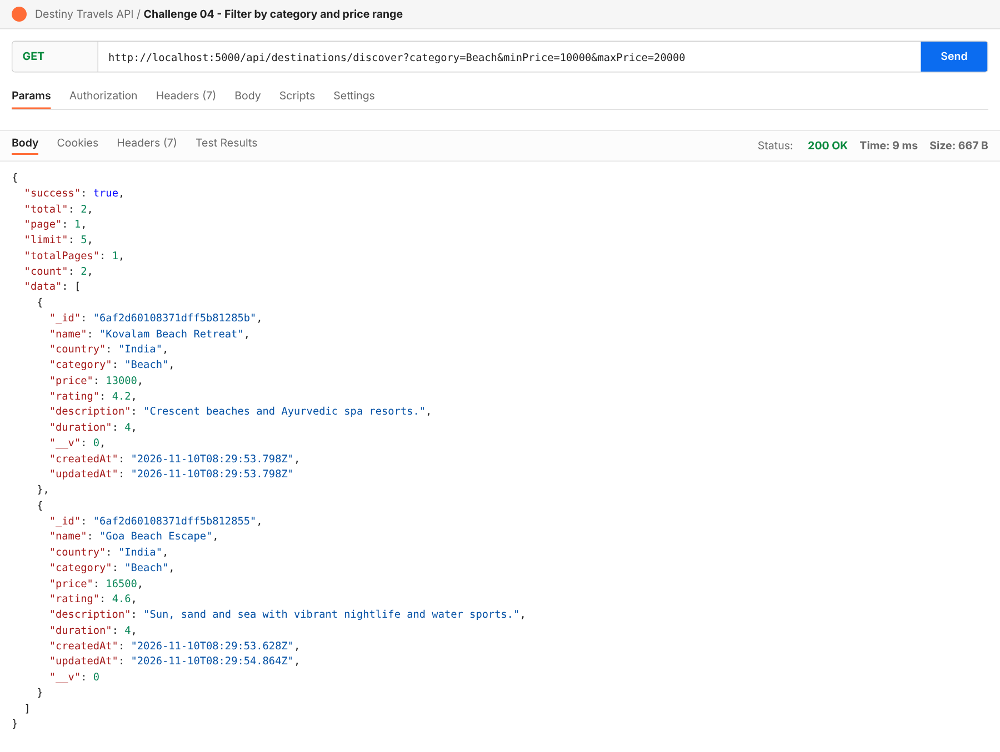
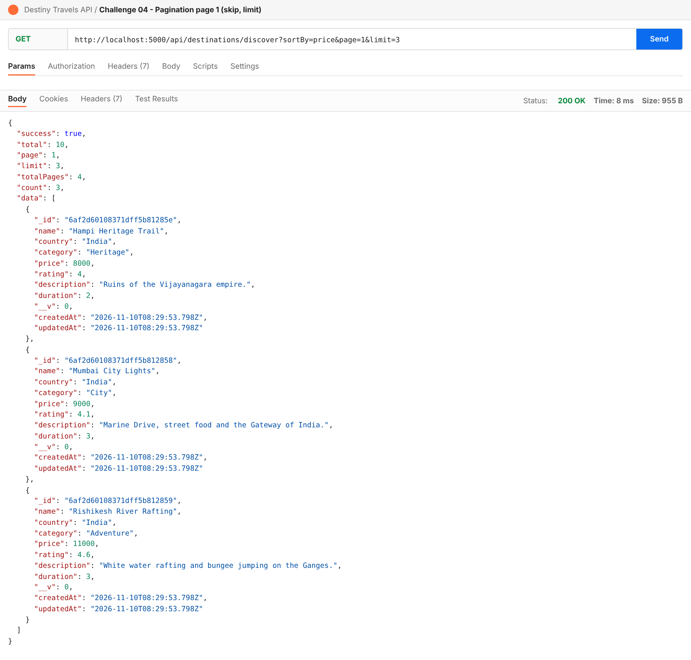
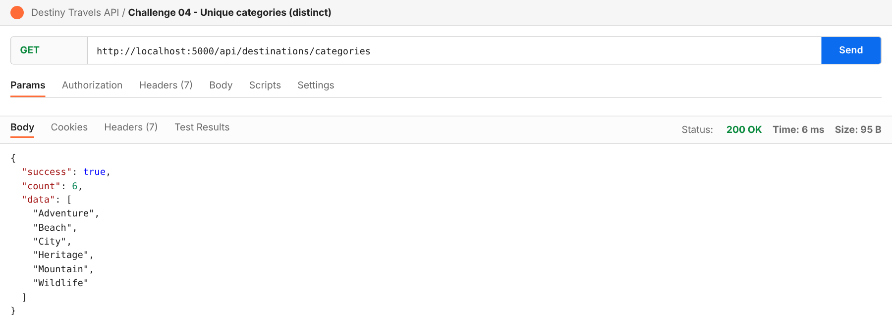
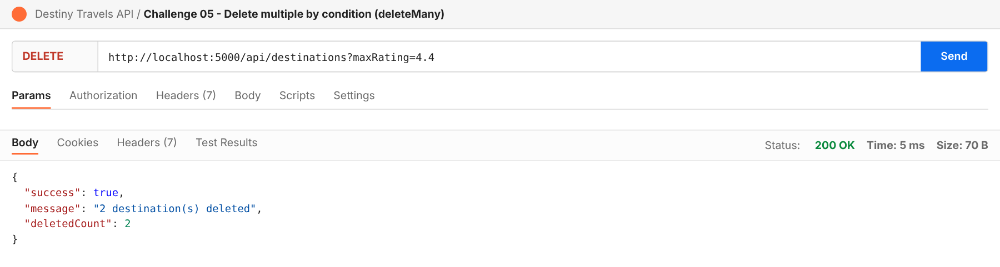
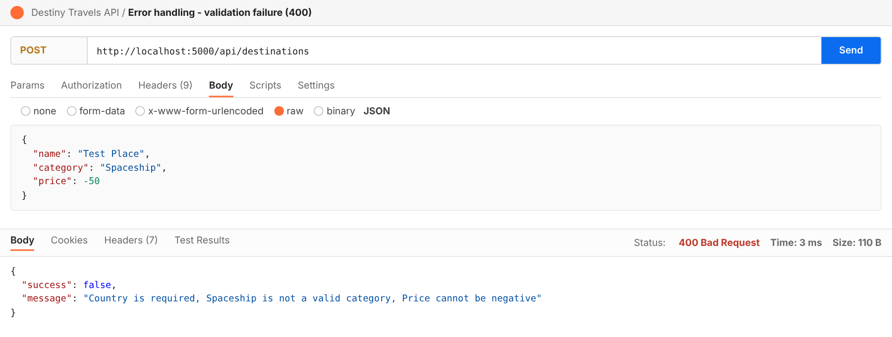

# Destiny Travels API


A RESTful back-end for managing travel destinations, built with **Node.js, Express.js, MongoDB and Mongoose** using the **MVC architecture**. It supports adding, retrieving, updating and deleting destinations, plus smart discovery with filtering, sorting, pagination, distinct values and counts.

- **Database:** `destiny_travels`
- **Collection:** `destinations`
- **Mongoose methods used:** 15 (`create`, `insertMany`, `find`, `findById`, `findOne`, `findByIdAndUpdate`, `findOneAndUpdate`, `sort`, `skip`, `limit`, `distinct`, `countDocuments`, `findByIdAndDelete`, `findOneAndDelete`, `deleteMany`)

## Table of Contents
1. [Features](#features)
2. [Tech Stack](#tech-stack)
3. [Project Structure](#project-structure)
4. [Getting Started](#getting-started)
5. [Environment Variables and Security](#environment-variables-and-security)
6. [Data Model](#data-model)
7. [API Reference](#api-reference)
8. [Example Requests and Responses](#example-requests-and-responses)
9. [Error Handling](#error-handling)
10. [Testing with Postman](#testing-with-postman)
11. [Screenshots](#screenshots)
12. [Author](#author)

## Features
- **Add:** one destination (`create`) or many at once (`insertMany`)
- **Retrieve:** all destinations, one by ID, or one by name (case-insensitive)
- **Update:** by ID or by name, with validation re-run on every update
- **Smart discovery:** filter by category and price range, sort by price and rating, paginate with `skip` and `limit`, list unique categories, count destinations
- **Cleanup:** delete by ID, by name, or many by condition (with a safety check so the whole collection cannot be wiped by accident)
- **Validation and error handling:** clear JSON errors with correct HTTP status codes

## Tech Stack
| Technology | Purpose |
|---|---|
| Node.js 18+ | Runtime |
| Express 5 | Routing and middleware |
| MongoDB | Database |
| Mongoose 9 | Schemas, validation, queries |
| dotenv | Loads environment variables |
| cors | Cross-origin requests |

## Project Structure
```
destiny_travells_using_mern/
├── config/
│   └── db.js                        # MongoDB connection
├── models/
│   └── Destination.js               # Mongoose schema and model
├── controllers/
│   └── destinationController.js     # Business logic for all five challenges
├── routes/
│   └── destinationRoutes.js         # URL to controller mapping
├── middleware/
│   └── errorHandler.js              # 404 and centralised error handling
├── postman/
│   └── Destiny_Travels_API.postman_collection.json
├── screenshots/                     # Postman outputs for every endpoint
├── server.js                        # Application entry point
├── .env.example                     # Template for environment variables
├── .gitignore
├── package.json
└── README.md
```

## Getting Started

### Prerequisites
- [Node.js](https://nodejs.org/) 18 or later
- MongoDB running locally, or a free [MongoDB Atlas](https://www.mongodb.com/atlas) cluster

### Installation
```bash
git clone https://github.com/Vicky-hue-ui/destiny_travells_using_mern.git
cd destiny_travells_using_mern
npm install
```

Create your environment file:

```bash
# macOS / Linux
cp .env.example .env

# Windows PowerShell
copy .env.example .env
```

Edit `.env` with your own values (see below), then start the server:

```bash
npm start        # runs: node server.js
npm run dev      # auto-restarts on file changes
```

The API is available at `http://localhost:5000`. Open it in a browser or Postman; you should see:

```json
{ "success": true, "message": "Welcome to Destiny Travels API" }
```

## Environment Variables and Security
Configuration is read from a `.env` file that is **never committed**: `.gitignore` excludes `.env`, `.env.*` (except `.env.example`), keys and certificates.

| Variable | Description | Example |
|---|---|---|
| `PORT` | Port the server listens on | `5000` |
| `MONGO_URI` | MongoDB connection string, ending in the `destiny_travels` database name | `mongodb://127.0.0.1:27017/destiny_travels` |

For **MongoDB Atlas**, use your own connection string, for example `mongodb+srv://<username>:<password>@<cluster>.mongodb.net/destiny_travels?retryWrites=true&w=majority`.

Security notes:
- Real credentials belong only in your local `.env` file, never in code, the README, screenshots or commits.
- If a password is ever committed by mistake, rotate it in Atlas immediately; deleting the file in a later commit does not remove it from Git history.
- Before pushing, run `git status` and confirm `.env` is not listed.

## Data Model
| Field | Type | Rules |
|---|---|---|
| `name` | String | Required, trimmed, unique |
| `country` | String | Required, trimmed |
| `category` | String | Required; one of `Beach`, `Mountain`, `Heritage`, `City`, `Adventure`, `Wildlife` |
| `price` | Number | Required, minimum 0 |
| `rating` | Number | 0 to 5, default 0 |
| `description` | String | Optional, trimmed |
| `duration` | Number | Days, minimum 1, default 3 |

`createdAt` and `updatedAt` are added automatically.

## API Reference
Base URL: `http://localhost:5000/api/destinations`

| Challenge | Method | Endpoint | Mongoose method |
|---|---|---|---|
| 01 Add | POST | `/` | `create()` |
| 01 Add | POST | `/bulk` | `insertMany()` |
| 02 Retrieve | GET | `/` | `find()` |
| 02 Retrieve | GET | `/:id` | `findById()` |
| 02 Retrieve | GET | `/name/:name` | `findOne()` |
| 03 Update | PUT | `/:id` | `findByIdAndUpdate()` |
| 03 Update | PUT | `/name/:name` | `findOneAndUpdate()` |
| 04 Discover | GET | `/discover` | `find()`, `sort()`, `skip()`, `limit()`, `countDocuments()` |
| 04 Discover | GET | `/categories` | `distinct()` |
| 04 Discover | GET | `/count` | `countDocuments()` |
| 05 Cleanup | DELETE | `/:id` | `findByIdAndDelete()` |
| 05 Cleanup | DELETE | `/name/:name` | `findOneAndDelete()` |
| 05 Cleanup | DELETE | `/` | `deleteMany()` |

### Query parameters
**`GET /discover`**

| Parameter | Description | Default |
|---|---|---|
| `category` | Exact category (case-insensitive) | all |
| `minPrice`, `maxPrice` | Price range | none |
| `sortBy` | `price`, `rating`, or `price,rating` | `price` |
| `order` | `asc` or `desc` | `asc` |
| `page` | Page number | `1` |
| `limit` | Items per page (maximum 50) | `5` |

**`GET /count`** accepts an optional `category`.

**`DELETE /`** requires at least one condition: `category`, `maxRating` (deletes ratings below the value) or `minPrice` (deletes prices above the value).

## Example Requests and Responses

**Add a destination**
```http
POST /api/destinations
Content-Type: application/json

{
  "name": "Goa Beach Escape",
  "country": "India",
  "category": "Beach",
  "price": 15000,
  "rating": 4.5,
  "description": "Sun, sand and sea with vibrant nightlife and water sports.",
  "duration": 4
}
```
Response `201 Created`:
```json
{
  "success": true,
  "message": "Destination added",
  "data": { "_id": "...", "name": "Goa Beach Escape", "category": "Beach", "price": 15000, "rating": 4.5 }
}
```

**Discover: Beach destinations between 10,000 and 20,000, cheapest first, 3 per page**
```http
GET /api/destinations/discover?category=Beach&minPrice=10000&maxPrice=20000&sortBy=price&page=1&limit=3
```
Response `200 OK`:
```json
{ "success": true, "total": 2, "page": 1, "limit": 3, "totalPages": 1, "count": 2, "data": [ ... ] }
```

**Delete many by condition**
```http
DELETE /api/destinations?maxRating=4.4
```
```json
{ "success": true, "message": "2 destination(s) deleted", "deletedCount": 2 }
```

## Error Handling
All errors return `{ "success": false, "message": "..." }`.

| Status | Meaning | When |
|---|---|---|
| 200 | OK | Successful GET, PUT, DELETE |
| 201 | Created | Successful `create()` or `insertMany()` |
| 400 | Bad Request | Validation failure, invalid ObjectId, or `DELETE /` with no condition |
| 404 | Not Found | Destination or route not found |
| 409 | Conflict | Destination name already exists |
| 500 | Server Error | Unexpected server or database error |

## Testing with Postman
1. Start the server (`npm start`).
2. In Postman choose **Import** and select `postman/Destiny_Travels_API.postman_collection.json`.
3. The collection uses a `baseUrl` variable (default `http://localhost:5000`).
4. Run the requests in order; they are numbered by challenge.

## Screenshots
Postman output for every endpoint is stored in [`screenshots/`](screenshots/). A selection:

| Add (`create`) | Add many (`insertMany`) |
|---|---|
|  |  |

| Retrieve by ID (`findById`) | Filter by category and price |
|---|---|
|  |  |

| Pagination (`skip`, `limit`) | Unique categories (`distinct`) |
|---|---|
|  |  |

| Delete many (`deleteMany`) | Validation error (400) |
|---|---|
|  |  |

## Author
Built as a Mongoose and Express.js learning project. Author: **Eren**.
